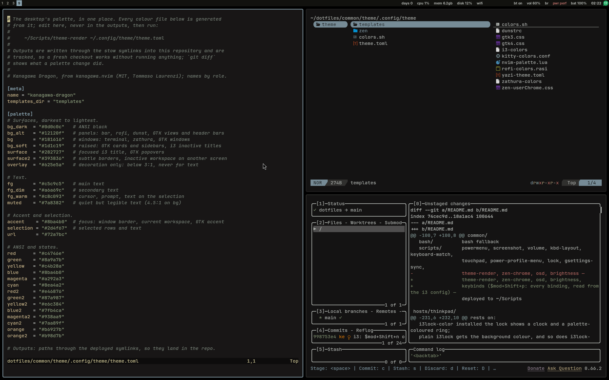

# dotfiles

i3 on X11, one colour theme everywhere (six to pick from), terminal apps over GUI ones. Arch Linux
on a ThinkPad; `common/` should run on any distro with i3 4.22+.



## Setup

| | |
|---|---|
| **WM** | [i3](https://i3wm.org) + [autotiling](https://github.com/nwg-piotr/autotiling) |
| **Bar** | i3bar + [i3blocks](https://github.com/vivien/i3blocks) |
| **Compositor** | [picom](https://github.com/yshui/picom) — dim, 4 px corners, short animations, no blur |
| **Launcher** | [rofi](https://github.com/davatorium/rofi) + rofi-emoji, clipmenu |
| **Notifications** | [dunst](https://dunst-project.org) (also the volume/brightness bars) |
| **Lock** | i3lock on pure black (OLED) + xss-lock |
| **Terminal** | [kitty](https://sw.kovidgoyal.net/kitty) |
| **Shell** | zsh + oh-my-zsh + powerlevel10k, fzf, zoxide |
| **Editor** | [neovim](https://neovim.io) with [LazyVim](https://www.lazyvim.org), colour scheme following the desktop theme |
| **Fetch** | [fastfetch](https://github.com/fastfetch-cli/fastfetch) — small Arch logo, Nerd Font keys, ANSI colours from kitty |
| **Files** | [yazi](https://github.com/sxyazi/yazi) |
| **Notes** | [tsuzuri](https://github.com/jaisuriya-11/tsuzuri) |
| **TUIs** | lazygit, lazydocker, btop, wiremix, bluetui, nmtui, spotify-player, dua |
| **Colours** | six themes, switched as a whole with `Super+t`: Kanagawa Dragon, Gruvbox Dark, Nord, Ayu Dark, Solarized Osaka, GitHub Dark |
| **Fonts** | Inter (interface), JetBrains Mono Nerd Font (monospace) |
| **GTK / icons** | adw-gtk3 recoloured to the palette, Papirus-Dark with folders in the theme's accent |
| **Background** | the theme's `bg` colour, nothing else (a 1-pixel XPM stretched by feh) |

## Install

**1. Packages** (Arch):

```sh
sudo pacman -S i3-wm i3blocks autotiling picom rofi rofi-emoji clipmenu dunst \
  i3lock xss-lock polkit-gnome xdg-desktop-portal-gtk kitty zsh \
  zsh-autosuggestions zsh-syntax-highlighting zsh-completions neovim yazi \
  zathura zathura-pdf-mupdf fastfetch btop lazygit lazydocker fzf fd ripgrep zoxide bat \
  eza jq glow tealdeer dua-cli duf wiremix bluetui spotify-player \
  brightnessctl playerctl maim xclip xorg-xrandr xorg-xinput xorg-xset feh \
  xorg-setxkbmap adw-gtk-theme papirus-icon-theme inter-font \
  ttf-jetbrains-mono-nerd noto-fonts noto-fonts-emoji power-profiles-daemon rtkit \
  pkgfile stow git
yay -S xbanish tsuzuri-bin
```

**2. oh-my-zsh**, cloned rather than installed (its installer overwrites
`~/.zshrc`), with the zsh plugins linked from pacman:

```sh
git clone --depth=1 https://github.com/ohmyzsh/ohmyzsh.git ~/.oh-my-zsh
git clone --depth=1 https://github.com/romkatv/powerlevel10k.git \
    ~/.oh-my-zsh/custom/themes/powerlevel10k
mkdir -p ~/.oh-my-zsh/custom/plugins
ln -sfn /usr/share/zsh/plugins/zsh-{autosuggestions,syntax-highlighting} \
    ~/.oh-my-zsh/custom/plugins/
```

**3. Deploy** with GNU Stow:

```sh
git clone https://github.com/kenjiknk/dotfiles ~/dotfiles
cd ~/dotfiles/common          && stow --target="$HOME" --no-folding *
cd ~/dotfiles/hosts/thinkpad  && stow --target="$HOME" --no-folding *   # this machine only
chsh -s /usr/bin/zsh
```

Log out and pick **i3** in the display manager.

**4. Optional, once per machine:** `~/Scripts/zen-chrome` themes Zen Browser;
`flatpak install flathub org.gtk.Gtk3theme.adw-gtk3-dark` themes Flatpak apps.

## Keybindings

`Super+Shift+p` lists every binding, read live from the i3 config. The main
ones:

| Key | Action |
|---|---|
| `Super+Enter` | terminal |
| `Super+d` | launch app |
| `Super+Shift+q` | close window |
| `Super+h/j/k/l` | focus (`+Shift` to move) |
| `Super+1…0` | workspace (`+Shift` to move the window) |
| `Super+f` | fullscreen |
| `Super+Shift+Space` | toggle floating |
| `Super+r` | resize mode |
| `Super+Shift+f` | files (yazi) |
| `Super+Shift+n` | notes (tsuzuri) |
| `Super+c` | clipboard history |
| `Super+.` | emoji |
| `Super+Shift+s` | screenshot |
| `Super+Shift+e` | power menu (lock, suspend, logout, reboot, shutdown) |
| `Super+Shift+c` | restart i3 in place |
| `Super+t` | desktop theme |
| `Super+y` / `Super+v` | yazi / Neovim cheat sheet (same key closes) |

Clicking a bar block opens its TUI: network → nmtui, bt → bluetui, volume →
wiremix, cpu/mem → btop.

## Structure

Each directory is a stow package that mirrors `$HOME`.

```
common/            any machine
  i3/ i3blocks/ picom/ dunst/ rofi/ kitty/ nvim/ yazi/ zathura/ fastfetch/
  gtk/ fontconfig/ flatpak/ xdg/
  theme/           the themes (palettes) and the templates every colour file comes from
  shell/ zsh/ bash/
  cheatsheets/     ~/.config/cheatsheets: yazi and Neovim sheets (Markdown)
  scripts/         ~/Scripts: lock, powermenu, volume, brightness, keybinds, ...
hosts/thinkpad/    this laptop only: keyboard layout, touchpad, TrackPoint, dock
assets/            the screenshot above
```

`common/i3` ends with `include ~/.config/i3/local`, which comes from
`hosts/<hostname>/`; a machine without one simply skips it.

## Colours

Each theme is one file in `common/theme/.config/theme/themes/`: a palette by
role (backgrounds, text, accent, error, ANSI) and the editors' own theme
names. `Super+t` (`~/Scripts/theme-switch`) picks one in rofi; also
`theme-switch nord`, or `theme-switch --list`.

A switch points `theme.toml` at that file and runs
`~/Scripts/theme-render`, which rewrites the colour files for i3 and the bar,
rofi, dunst, kitty, GTK/Qt, zathura, yazi, Zen, Neovim, Tsuzuri, btop,
spotify-player, lazygit, lazydocker, glow (through an alias, `glow -s`) and fzf
(`FZF_DEFAULT_OPTS_FILE`), recolours Papirus' folders to the accent
(`~/Scripts/icon-accent`, a user icon theme `Papirus-Dark-Accent` that needs no
root), and reloads i3, dunst and kitty. It also sets VS Code's theme and runs
`:ThemeReload` in every open Neovim. GTK/Qt apps, yazi, zathura, Zen and the
TUIs change when reopened.

Terminal programs without their own colour file follow the theme through
kitty's 16 ANSI colours: the prompt, bat (`--theme=ansi`) and man pages
(`MANPAGER` through bat), eza, fastfetch, tealdeer, nmtui, wiremix, bluetui.
Not themed: Discord (the official client has no themes; Vesktop would),
Spotify's own app (needs Spicetify), the lock screen (plain i3lock: black by
design) and Flatpak apps' icons.

To add a theme, copy a file in `themes/`, change its colours and `[meta]`,
and add its Neovim plugin to `lua/plugins/theme.lua`. To change the current one, edit its
file and run `~/Scripts/theme-render ~/.config/theme/theme.toml`. The
generated files are tracked, so a fresh clone needs no render step, and it
starts on the theme last picked. Needs Python 3.11+.

Editor themes, installed once per machine:

```sh
code --install-extension metaphore.kanagawa-vscode-color-theme   # and:
code --install-extension jdinhlife.gruvbox
code --install-extension arcticicestudio.nord-visual-studio-code
code --install-extension teabyii.ayu
code --install-extension sherloach.solarized-osaka
code --install-extension GitHub.github-vscode-theme
```

Neovim (LazyVim) installs its plugins and six colour schemes on first start, pinned in `lazy-lock.json`.

## Notes

- Always pass `--no-folding` to stow: both layers write into `~/Scripts`.
- Programs that save by renaming over a file (e.g. `p10k configure`,
  `flatpak override --user`) replace the stow symlink; `stow --restow` again
  afterwards.
- The lock pauses notifications and media while the screen is locked.
- With the DisplayLink dock (evdi), Xorg's modesetting driver can segfault in
  `msEnableSharedPixmapFlipping` when a screen is set up, which kills the
  session. DisplayLink's workaround is to turn page flipping off. It lives in
  `/etc`, so stow does not carry it; on a new install create
  `/etc/X11/xorg.conf.d/20-displaylink.conf`:

  ```
  Section "OutputClass"
      Identifier "amdgpu-no-pageflip"
      MatchDriver "amdgpu"
      Driver "modesetting"
      Option "PageFlip" "false"
  EndSection

  Section "OutputClass"
      Identifier "evdi-no-pageflip"
      MatchDriver "evdi"
      Driver "modesetting"
      Option "PageFlip" "false"
  EndSection
  ```
- No secrets are tracked; `.gitignore` blocks keys, shell history and browser
  profiles.

## Credits

Palettes: [kanagawa.nvim](https://github.com/rebelot/kanagawa.nvim) (Tommaso
Laurenzi, MIT), [gruvbox](https://github.com/morhetz/gruvbox) (Pavel Pertsev),
[Nord](https://github.com/nordtheme/nord) (MIT),
[ayu](https://github.com/ayu-theme/ayu-colors) (MIT),
[solarized-osaka.nvim](https://github.com/craftzdog/solarized-osaka.nvim)
(Apache-2.0) and [GitHub Primer](https://github.com/primer/primitives) (MIT).

Originally based on
[vyrx-dev/dotfiles](https://github.com/vyrx-dev/dotfiles); the yazi theme
derives from their "Symphony".

No licence: all rights reserved. Check the upstream projects' terms before
reusing their parts.
