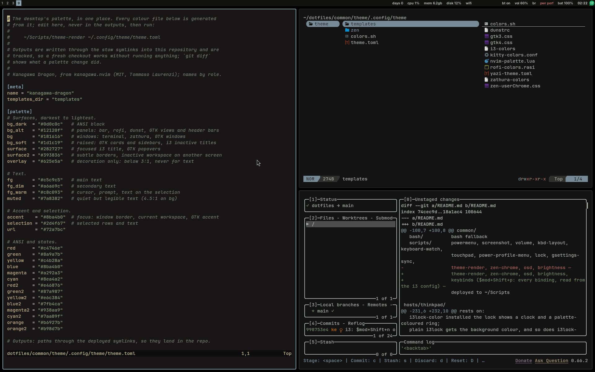

# dotfiles

i3 on X11, Kanagawa Dragon everywhere, terminal apps over GUI ones. Arch Linux
on a ThinkPad; `common/` should run on any distro with i3 4.22+.



## Setup

| | |
|---|---|
| **WM** | [i3](https://i3wm.org) + [autotiling](https://github.com/nwg-piotr/autotiling) |
| **Bar** | i3bar + [i3blocks](https://github.com/vivien/i3blocks) |
| **Compositor** | [picom](https://github.com/yshui/picom) — dim, 4 px corners, short animations, no blur |
| **Launcher** | [rofi](https://github.com/davatorium/rofi) + rofi-emoji, clipmenu |
| **Notifications** | [dunst](https://dunst-project.org) (also the volume/brightness bars) |
| **Lock** | [xsecurelock](https://github.com/google/xsecurelock) + xss-lock, with a fade before locking |
| **Terminal** | [kitty](https://sw.kovidgoyal.net/kitty) |
| **Shell** | zsh + oh-my-zsh + powerlevel10k, fzf, zoxide |
| **Editor** | [neovim](https://neovim.io) with [kanagawa.nvim](https://github.com/rebelot/kanagawa.nvim) |
| **Files** | [yazi](https://github.com/sxyazi/yazi) |
| **Notes** | [tsuzuri](https://github.com/jaisuriya-11/tsuzuri) |
| **TUIs** | lazygit, lazydocker, btop, wiremix, bluetui, nmtui, spotify-player, dua |
| **Colours** | [Kanagawa Dragon](https://github.com/rebelot/kanagawa.nvim), one file for the whole desktop |
| **Fonts** | Inter (interface), JetBrains Mono Nerd Font (monospace) |
| **GTK / icons** | adw-gtk3 recoloured to the palette, Papirus-Dark |
| **Background** | none — pure black, pixels off on OLED |

## Install

**1. Packages** (Arch):

```sh
sudo pacman -S i3-wm i3blocks autotiling picom rofi rofi-emoji clipmenu dunst \
  xsecurelock xss-lock polkit-gnome xdg-desktop-portal-gtk kitty zsh \
  zsh-autosuggestions zsh-syntax-highlighting zsh-completions neovim yazi \
  zathura zathura-pdf-mupdf btop lazygit lazydocker fzf fd ripgrep zoxide bat \
  eza jq glow tealdeer dua-cli duf wiremix bluetui spotify-player \
  brightnessctl playerctl maim xclip xorg-xrandr xorg-xinput xorg-xset \
  xorg-setxkbmap adw-gtk-theme papirus-icon-theme inter-font \
  ttf-jetbrains-mono-nerd noto-fonts noto-fonts-emoji power-profiles-daemon \
  pkgfile stow git
yay -S xbanish tsuzuri-bin
```

**2. oh-my-zsh**, cloned rather than installed (its installer overwrites
`~/.zshrc`), with the zsh plugins linked from pacman:

```sh
git clone --depth=1 https://github.com/ohmyzsh/ohmyzsh.git ~/.oh-my-zsh
git clone --depth=1 https://github.com/romkatv/powerlevel10k.git \
    ~/.oh-my-zsh/custom/themes/powerlevel10k
mkdir -p ~/.oh-my-zsh/custom/plugins
ln -sfn /usr/share/zsh/plugins/zsh-{autosuggestions,syntax-highlighting} \
    ~/.oh-my-zsh/custom/plugins/
```

**3. Deploy** with GNU Stow:

```sh
git clone https://github.com/kenjiknk/dotfiles ~/dotfiles
cd ~/dotfiles/common          && stow --target="$HOME" --no-folding *
cd ~/dotfiles/hosts/thinkpad  && stow --target="$HOME" --no-folding *   # this machine only
chsh -s /usr/bin/zsh
```

Log out and pick **i3** in the display manager.

**4. Optional, once per machine:** `~/Scripts/zen-chrome` themes Zen Browser;
`flatpak install flathub org.gtk.Gtk3theme.adw-gtk3-dark` themes Flatpak apps.

## Keybindings

`Super+Shift+p` lists every binding, read live from the i3 config. The main
ones:

| Key | Action |
|---|---|
| `Super+Enter` | terminal |
| `Super+d` | launch app |
| `Super+Shift+q` | close window |
| `Super+h/j/k/l` | focus (`+Shift` to move) |
| `Super+1…0` | workspace (`+Shift` to move the window) |
| `Super+f` | fullscreen |
| `Super+Shift+Space` | toggle floating |
| `Super+r` | resize mode |
| `Super+Shift+f` | files (yazi) |
| `Super+Shift+n` | notes (tsuzuri) |
| `Super+c` | clipboard history |
| `Super+.` | emoji |
| `Super+Shift+s` | screenshot |
| `Super+Shift+e` | power menu (lock, suspend, logout, reboot, shutdown) |
| `Super+Shift+c` | restart i3 in place |

Clicking a bar block opens its TUI: network → nmtui, bt → bluetui, volume →
wiremix, cpu/mem → btop.

## Structure

Each directory is a stow package that mirrors `$HOME`.

```
common/            any machine
  i3/ i3blocks/ picom/ dunst/ rofi/ kitty/ nvim/ yazi/ zathura/
  gtk/ fontconfig/ flatpak/ xdg/
  theme/           the palette and the templates every colour file comes from
  shell/ zsh/ bash/
  scripts/         ~/Scripts: lock, powermenu, volume, brightness, keybinds, ...
hosts/thinkpad/    this laptop only: keyboard layout, touchpad, TrackPoint, dock
assets/            the screenshot above
```

`common/i3` ends with `include ~/.config/i3/local`, which comes from
`hosts/<hostname>/`; a machine without one simply skips it.

## Colours

Everything comes from `common/theme/.config/theme/theme.toml`. To change the
palette, edit it and run:

```sh
~/Scripts/theme-render ~/.config/theme/theme.toml
```

It rewrites the colour files for i3 and the bar, rofi, dunst, kitty, GTK,
zathura, yazi, nvim and Zen, then reloads what it can. The generated files are
tracked, so a fresh clone needs no render step. Needs Python 3.11+.

## Notes

- Always pass `--no-folding` to stow: both layers write into `~/Scripts`.
- Programs that save by renaming over a file (e.g. `p10k configure`,
  `flatpak override --user`) replace the stow symlink; `stow --restow` again
  afterwards.
- The lock pauses notifications and media while the screen is locked, and falls
  back to plain i3lock if xsecurelock is missing.
- No secrets are tracked; `.gitignore` blocks keys, shell history and browser
  profiles.

## Credits

[kanagawa.nvim](https://github.com/rebelot/kanagawa.nvim) by Tommaso Laurenzi
(palette, MIT). Originally based on
[vyrx-dev/dotfiles](https://github.com/vyrx-dev/dotfiles); the yazi theme
derives from their "Symphony".

No licence: all rights reserved. Check the upstream projects' terms before
reusing their parts.
